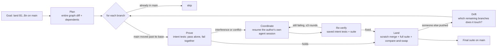

# Interlock

**AI coding agents pass alone and break together. Interlock lands their changes safely.**

Give Interlock a goal, `land these AI-written branches on main`, and it finishes only when every change is merged **and** the combined code is proven consistent. Along the way it:
- finds the changes that pass alone but fail together;
- **proves** each one with a test that passes on the change's own branch and fails on the merge;
- sends the fix request **to the agent that wrote the change**, by resuming its own session (found through its Entire checkpoint);
- re-verifies the result;
- keeps going while `main` moves underneath it.

Built during [#neatHack](https://neatlogs.com/hackathon) (Oct 10-12, 2026) with **neatlogs** (every run traced), **Entire** (checkpoints + entire-graph, used to build Interlock *and* inside it) and **cfo.ai** (business plan).

---

## The bug that motivated it (real, from our experiment)

We gave three Claude Code agents three tasks on the same small shop codebase: integer cents, a small-order fee, and a discount code. Each agent's branch passed its own tests (21 / 19 / 26). When git merged agent #1 and agent #2, it auto-merged these lines **without any conflict**:

```python
SHIPPING_FLAT = 500              # cents   (agent #1)
FREE_SHIPPING_THRESHOLD = 5000   # cents   (agent #1)
SMALL_ORDER_FEE = 1.50           # dollars (agent #2)
SMALL_ORDER_THRESHOLD = 15.00    # dollars (agent #2)
```

Amounts are now counted in cents, so every order is "over $15" and the fee silently never applies. Code review looks at one PR at a time, so nobody reviews the combination. Research agrees: *"Passes Alone, Fails Together"* ([arXiv 2609.25396](https://arxiv.org/abs/2609.25396), Sept 2026) found interference in 97% of constructed parallel-agent runs, and that telling the agent what the other change did fixes 82% of them. Interlock automates exactly that.

## How it works



| Step | What happens | Tools |
|---|---|---|
| **Plan** | Entity-level changes per branch and how many dependents they have. Providers (widely used contracts) land first. | `entire graph diff --json` |
| **Overlap** | Which changed entities on one branch the other branch touches or calls | `entire graph impact --format json` |
| **Intent** | For changed lines: was the author an AI? Which session, model and **original prompt**? | `entire why FILE:LINE --json` |
| **Prove** | Merge in a scratch worktree (conflicts → automated resolver). Synthesize an intent test per side and keep it only if it passes on its own branch. A failure on the merge is the proof. | git worktrees, pytest, Claude via LiteLLM |
| **Decide** | Who adapts: the side building on a contract the other changed on purpose | Claude Haiku |
| **Coordinate** | A precise fix request (what changed, before → after, the failing intent tests), delivered by **resuming the agent's own Claude Code session** in its worktree | `claude -p --resume <session>`, `entire session attach` |
| **Re-verify** | Never trust "fixed". Run the saved intent tests plus the full suite on the new head. | pytest |
| **Land** | Scratch merge + full suite, then `update-ref new old`: a concurrent push fails the swap and becomes drift | git |
| **Drift** | New commits on the target → the remaining branches whose entities they change *or call* are re-proved. The others land directly. | `entire graph diff/impact` |

Everything is traced in **neatlogs**: workflow → agents (planner, intent, prover, coordinator, lander) → every tool call (git, entire, pytest, claude) and every LLM call, with cost from LiteLLM's cost header and cache hits.

### The 8 focus areas

| Focus area | In Interlock |
|---|---|
| Planning | Landing order from the dependency graph. Re-plans on drift. |
| Tool use | git, entire (graph diff/impact, why, session attach), pytest, claude, LiteLLM. Every call is structured and never raises on failure. |
| State | Per-run `state.json` written after every step. `interlock resolve --resume <run>`. |
| Context | entire-graph narrows the model input to the overlapping entities and files. Pairs with no shared entities never reach a model. |
| Execution | Goal mode runs unattended until every branch is landed or escalated |
| Recovery | Test repair loop, next fix round with the failure output, CAS retry on concurrent push, budget cap → deterministic mode, escalation |
| Verification | An objective "passes alone, fails together" oracle, re-verification after every fix, the final suite on the target |
| Iteration | Each proof or verification result chooses the next action (land, coordinate, retry, re-plan, escalate) |

## Results so far

| Run | What happened | Evidence |
|---|---|---|
| Fleet #1 | 3 Claude Code agents, same base, each branch green (21/19/26 tests); every pair conflicts textually; silent dollars-vs-cents constants auto-merged | `hackathon.md` |
| `prove` issue-2 × issue-1 | Interference proven in **both** directions (`NameError: round_money` after the automated resolution); **$0.062**, 47 s | `evidence/runs/20261011-013325/` |
| `resolve` issue-2 × issue-1 | Agent #2's own session resumed with the fix request → fee moved to cents, 30/30 tests, re-verified → **resolved in 1 round, $0.0011 of Interlock LLM** | `evidence/runs/20261011-013837/` |
| `land` issue-1, -2, -3 | All three landed. Agent #3 coordinated in 1 round (interference in both directions + 3 conflicted files). **Final suite 48/48.** | `evidence/runs/land-20261011-023216/` |
| `land` #4, #5, #1 **while a teammate pushes** | The concurrent push failed Interlock's compare-and-swap → drift analysis: the banner's new code depends on `Cart.subtotal`/`price_of`/`round_money`, so only #1 is affected → #1 re-proved, agent #1 coordinated, a contradictory acceptance test re-expressed (arbitration) → **DONE in 2.5 min, 48/48** | `evidence/runs/land-20261011-031600/` |
| `eval`: 8 labelled pairs of real agent branches | **Merge queue (v1): recall 1.0, precision 0.40 (3 false alarms). Interlock v2.3: recall 1.0, precision 1.0, $0.38 for all 8 pairs** (3 improvement loops, see [EVIDENCE.md](EVIDENCE.md)) | `eval/results/` |

## Quickstart

```bash
uv sync
cp .env.example .env    # LITELLM_API_KEY, NEATLOGS_API_KEY (and CRUSTDATA_API_KEY for the market script)
# Entire CLI + graph plugin: https://docs.entire.io/installation ; `entire plugin install graph`

uv run interlock prove agent/issue-2 agent/issue-1 --repo ../interlock-demo-shop
uv run interlock resolve agent/issue-2 agent/issue-1 --repo ../interlock-demo-shop
uv run interlock land agent/issue-1 agent/issue-2 agent/issue-3 --into main --repo ../interlock-demo-shop
uv run interlock eval --mode v2 --suite eval/scenarios.json --repo ../interlock-demo-shop
```

The demo environment and its agent branches (with their Entire checkpoints) are at [interlock-demo-shop](https://github.com/23f2001033/interlock-demo-shop). The agent fleet is `scripts/fleet.sh`.

## How we used the hackathon tools

- **neatlogs:** every Interlock run is traced (spans for plan/intent/prove/coordinate/land, every tool call, every model call with cost and cache hits). We used the traces to find failures and compare runs before and after each improvement; see [EVIDENCE.md](EVIDENCE.md).
- **Entire:**
  - *Inside the product:* `entire graph diff/impact` for planning, overlap and drift; `entire why --json` for each change's agent, session and original prompt; `entire session attach` to link coordinated commits back to the agent session.
  - *While building:* every agent commit in the demo repo carries an Entire checkpoint, and the checkpoint refs are pushed for anyone to inspect.
- **cfo.ai:** pricing, costs (measured cost per proof), revenue scenarios and runway. See [business-plan/](business-plan/).
- Also used: **LiteLLM** (Nova + Claude, with a $20 budget enforced by Interlock's governor) and **Crustdata** (125,562 job postings since Jan 2026 mention AI coding tools, across ≥ 1,000 companies).

## Layout

```
src/interlock/   cli · lander (goal mode) · coordinator · prover · entire · gitops · testrun · llm · tracing · prompts/
scripts/         fleet.sh (agent fleet) · teammate_push.sh (simulated human push) · market_size.py (Crustdata)
eval/            scenarios.json (labelled pairs) · results/
evidence/        saved run reports and state files
business-plan/   plan.md + Crustdata market data (+ cfo.ai exports)
hackathon.md     dated build log (official neatHack skill)
```

## Limitations

- Python + pytest repos for now. The intent tests depend on the target having a runnable suite.
- Coordination resumes Claude Code sessions. Other agents go through adapters (Orchestrator `ao send` is next).
- Ground-truth labels in the eval are human judgements, stated in `eval/scenarios.json`.
